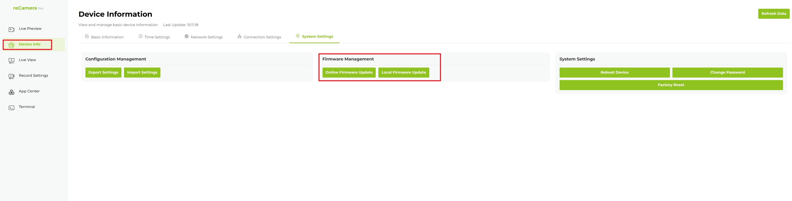
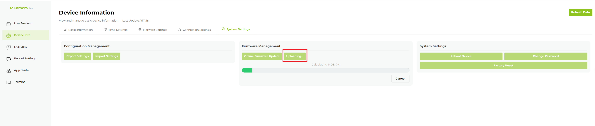
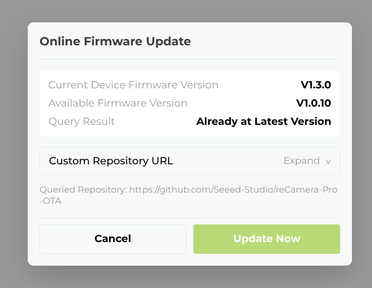
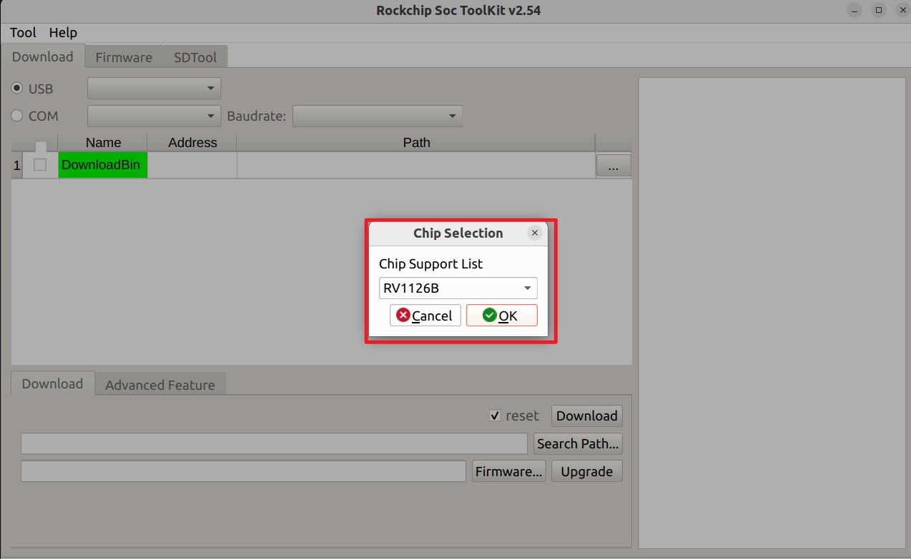
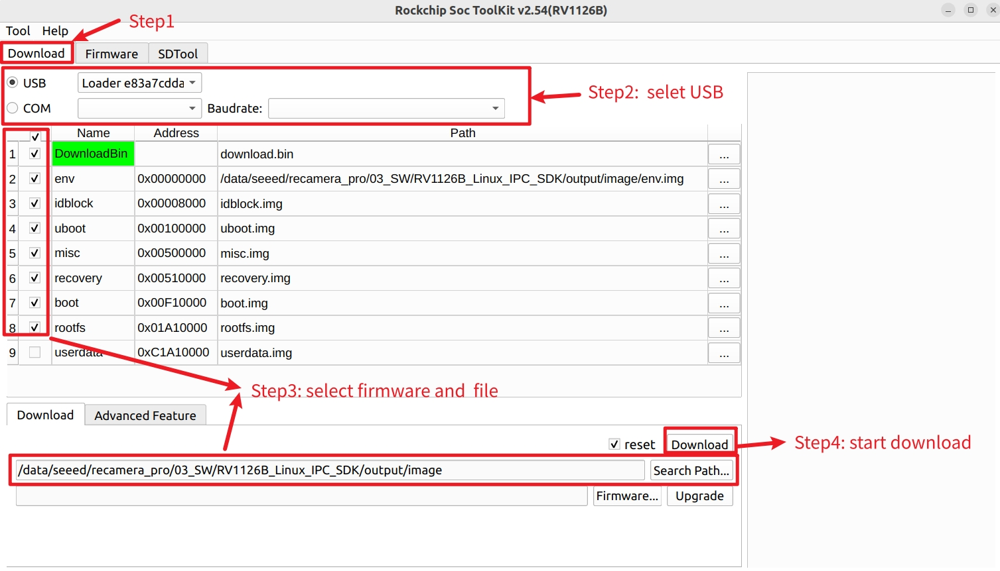

# reCamera Pro — Firmware & OTA

**English** | [简体中文](README_zh.md)

Official firmware release and flashing repository for the **reCamera Pro** AI camera.
Everything in one place: OTA update packages, Web-UI update guide, PC flashing tools,
and a technical deep-dive into how OTA works on the device.

---

## Table of contents

1. [Meet reCamera Pro](#1-meet-recamera-pro)
2. [Update firmware over the air (OTA)](#2-update-firmware-over-the-air-ota)
3. [Flash the full firmware from a PC](#3-flash-the-full-firmware-from-a-pc)
4. [Troubleshooting](#4-troubleshooting)
5. [Links & support](#5-links--support)

---

## 1. Meet reCamera Pro


reCamera Pro is an **open AI camera** built on the Rockchip **RV1126B**. It runs a full
Linux system with a browser-based UI, a 3 TOPS NPU for on-device inference, and standard
IP-camera protocols — so it is more than "just people detection": it is a programmable
edge-AI vision device you can deploy, extend and integrate.

| Item | Specification |
| --- | --- |
| Processor | RV1126B — quad-core Cortex-A53 @ 1.2 GHz |
| NPU | 3 TOPS (mixed INT8 / INT16) |
| Memory | LPDDR4 2 GB |
| Storage | 16 GB eMMC; microSD up to 512 GB |
| Camera | SC850SL, up to 4K@30 fps |
| Connectivity | Gigabit Ethernet (1000 Mbps), Wi-Fi 5, Bluetooth 5.2 |
| Interfaces | USB Type-C (OTG), debug UART, CAN ×2, MIPI DSI, GPIO |
| Power | DC 12–24 V (5525 barrel), PoE, 7.4 V Li-ion battery |

**Get one:** <https://www.seeedstudio.com/reCamera-Pro-2GB.html>

**Get started (setup, networking, first detection task, LED meanings):**
<https://wiki.seeedstudio.com/recamera_pro_getting_started/>

Out of the box the device serves its Web UI at `http://192.168.42.1`. The first login
password is `recamera`; you are then asked to change it for the `admin` account.

---

## 2. Update firmware over the air (OTA)

There are two ways to update: **local** (upload a package you downloaded) and **online**
(the device queries GitHub Releases for you). Both end up in the same place — the device
reboots into its recovery system, writes the new firmware to eMMC, reboots back into the
new system, and **keeps all your data**.

> New to the device? The [wiki getting-started guide](https://wiki.seeedstudio.com/recamera_pro_getting_started/)
> covers first login, networking and the Web UI layout.

> **Before you start**
>
> - **Back up your configuration.** Go to **Device Info → System Settings → Configuration
>   Management** and click **Export Settings**. The camera downloads a `config.tar` with
>   your settings (passwords and device keys are deliberately excluded). Keep it safe —
>   you can restore it later with **Import Settings**.
> - **Keep the power steady.** Do not unplug the camera or cut its power while the update
>   is running (the status LED blinks about every 100 ms). A power cut mid-write can leave
>   the camera unable to boot — see [§2.3](#23-what-happens-during-an-update) and
>   [§4 Troubleshooting](#4-troubleshooting).

### Where to find the update buttons

Open the Web UI, go to **Device Info → System Settings**, and look at the
**Firmware Management** card.



> The same page shows **Current Device Firmware Version**; use it after an update to
> confirm the new version.

### 2.1 Local firmware update (upload `update_ota.tar`)

Use this when you have the package on your computer, when the camera has no internet
access, or when you want to install a specific version.

1. Download `update_ota.tar` for the version you want from the
   [Releases page](https://github.com/Seeed-Studio/reCamera-Pro-OTA/releases).
   Keep the file name and extension as-is — do not unzip or re-compress it.
2. In the Web UI click **Local Firmware Update** and select the `update_ota.tar` file.
3. The browser uploads the package (about 1.4 GB) while computing its MD5; the device
   verifies it. The card shows upload progress and `Calculating MD5`:

   

4. When the upload finishes and the checksum matches, the device reboots into recovery
   and writes the firmware. **Do not power off during this step.** The status LED blinks
   at about 100 ms while the update is running.
5. The device reboots into the new firmware automatically. Check the version on
   **Device Info**.

Requirements for a package to be accepted:

- `.tar` archive, not compressed (no `.tar.gz`), named `update_ota.tar`;
- must contain `boot.img`, `rootfs.img` and `RK_OTA_update.sh`;
- `uboot.img` is optional.

### 2.2 Online firmware update

Use this when the camera has internet access. By default the device queries the official
repository **<https://github.com/Seeed-Studio/reCamera-Pro-OTA>** — i.e. this repository.

1. Click **Online Firmware Update**. The device queries the latest release and shows the
   current version, the available version and the query result:

   

2. If a newer version is available, click **Update Now**. The device downloads the
   package in the background (resumable, with retries), verifies it, reboots into
   recovery and applies it — exactly the same install path as the local update.
   Download progress is shown in the same card and can be cancelled.
3. If the result is `Already at Latest Version`, there is nothing to do.

**Custom repository.** Expand **Custom Repository URL** in the dialog to point the device
at another GitHub repository — useful for your own products, private builds, or a
staging fork. The repository must publish GitHub **Releases** whose first non-checksum
asset is a valid `update_ota.tar` (same archive requirements as above).

### 2.3 What happens during an update

- The camera restarts twice: once into recovery to write the firmware, once into the new
  system.
- The whole process typically takes a few minutes; the status LED blinks quickly while
  writing.
- **Avoid cutting power while the LED is blinking.** There is no A/B slot and no automatic
  rollback: the firmware is written in place. If power is lost mid-write, the camera does
  **not** return to recovery by itself — the next boot tries whatever is on the partitions
  and usually fails. The recovery system and the staged package do survive, though: unplug
  USB, **hold BOOT and power-cycle**, and U-Boot boots recovery, which re-runs the update
  from the beginning. (Holding BOOT *with* a USB cable attached enters rockusb mode
  instead.) The one case where this does not help is an interruption while `uboot.img` is
  written — it is the last image, so the bootloader itself can end up corrupt and the camera
  has to be reflashed from a PC (Part 3).
- If the package is rejected during upload (wrong contents or checksum), nothing is
  written and the device keeps running as before.
- If the write itself fails, recovery stops mid-way and does not reboot. Power-cycle the
  camera: if it boots the old system, the staged package is deleted on that boot and you
  have to upload it again; if it does not boot, re-enter recovery with BOOT and retry.

### 2.4 Your data is preserved

Configuration, the admin password and keys, recording rules, AI models, recorded videos
and photos all live in the **`userdata`** partition (mounted at `/userdata`). An OTA
package never contains `userdata.img`, and the updater only writes partitions that have a
matching image inside the package — so `userdata` is never written or formatted by an
update. **Your settings, recordings and photos survive OTA.**

Only **Factory Reset** (same page) wipes `userdata`. Back up before using it.

Want to know exactly which partitions are touched, and why a power cut is the main risk?
Read the technical note: [docs/OTA_DESIGN.md](docs/OTA_DESIGN.md).

---

## 3. Flash the full firmware from a PC

Flashing from a PC rewrites the boot chain and the system partitions (bootloader,
recovery, kernel, rootfs) with images you choose. Use it when the device does not boot,
when you want a clean factory state, or when you need a partition layout change. For
normal upgrades, prefer OTA (Part 2).

> **Before you flash**
>
> - **Back up your configuration and recordings.** If the camera still boots, export your
>   settings (**Device Info → System Settings → Configuration Management → Export
>   Settings**) and copy any videos or photos you want to keep off the camera. `rkflash.sh
>   all` keeps `userdata`, but `erase` and a factory reset wipe it — treat the data as
>   at-risk.
> - **Keep the power and the USB cable connected.** Do not unplug USB, cut power or press
>   RESET while the download is running. An interrupted flash leaves the camera without a
>   complete firmware image, and you have to flash it again from the start (re-enter boot
>   mode with BOOT + RESET if necessary).

### 3.1 Get the tools

All flashing tools are bundled in this repository — see [tools/README.md](tools/README.md)
for a full description of each one.

| Platform | Tool | Location |
| --- | --- | --- |
| Windows | SocToolKit (GUI) | [`tools/windows/SocToolKit`](tools/windows/SocToolKit) |
| Windows | USB driver installer | [`tools/windows/DriverAssitant_v5.12.zip`](tools/windows/DriverAssitant_v5.12.zip) |
| Linux | SocToolKit (GUI) | [`tools/linux/SocToolKit`](tools/linux/SocToolKit) |
| Linux | `upgrade_tool` CLI + `rkflash.sh` | [`tools/linux`](tools/linux) |

On Windows, run the driver installer **before** connecting the camera in boot mode.
On Linux, run SocToolKit as root and install the udev rule
`tools/linux/SocToolKit/88-rockusb.rules` (see [tools/README.md](tools/README.md)).

### 3.2 Get the image package

Download the full image package for your version from the
[Releases page](https://github.com/Seeed-Studio/reCamera-Pro-OTA/releases) and extract it.
You should end up with a folder containing:

```
firmware/
├── download.bin      # loader used for Maskrom -> Loader
├── env.img           # U-Boot environment (contains the partition table)
├── idblock.img       # loader / DDR init
├── uboot.img         # U-Boot
├── misc.img          # boot command block (BCB)
├── recovery.img      # recovery system
├── boot.img          # kernel + device tree
└── rootfs.img        # root filesystem
```

> If a release only publishes `update_ota.tar`, use the OTA update described in Part 2
> instead — an OTA package cannot restore a device that no longer boots.

### 3.3 Step 1 — Put the device into boot (Loader / Maskrom) mode

1. Connect the camera to your PC with a **data-capable** USB Type-C cable.
2. Power on the camera.
3. **Hold the BOOT button, then press RESET once, then release both.**

The device now stays in rockusb mode instead of booting Linux. SocToolKit / `upgrade_tool`
will list it as a connected device.

### 3.4 Step 2 — Open SocToolKit and select the SoC

Launch SocToolKit and confirm the chip is **RV1126B**:



Use **Tool → Chip Selection** if the dialog does not appear.

### 3.5 Step 3 — Select USB and the images, then download

1. On the **Download** tab choose **USB** (not COM).
2. Click **Search Path…** and select the extracted firmware folder; SocToolKit fills the
   image list from that folder.
3. Make sure the images are selected (including `DownloadBin`), then click **Download**.

   

> **Do not tick `userdata.img`.** If your image folder contains one, leave the `userdata`
> row unchecked: it is the grow-to-end partition holding your settings, recordings and
> photos, and writing that image overwrites them. The official image package does not
> include it.

The tool writes every image to its partition, restarts the device and shows a success
message. Remove USB and let the camera boot.

### 3.6 Linux command-line alternative

The bundled `rkflash.sh` wraps `upgrade_tool`, verifies every offset against the partition
table inside `env.img`, and refuses unsafe writes:

```bash
cd tools/linux

# Put the image package in <repo-root>/firmware, then:
./rkflash.sh all        # flash system partitions, keep misc + userdata
./rkflash.sh system     # same as "all"
./rkflash.sh rd         # reset the connected device
./rkflash.sh loader     # upgrade only the loader
./rkflash.sh update /path/to/update.img   # flash a full update.img
```

Everyday flashing (`all` / `system`) deliberately **preserves `misc` and `userdata`**, so
your recordings and settings stay. Other options:

```bash
RKFLASH_DRY_RUN=1 ./rkflash.sh all          # validate and print commands, touch nothing
RKFLASH_IMAGE_DIR=/path/to/firmware ./rkflash.sh all
./rkflash.sh factory-reset                  # flash the factory-reset flag; next boot wipes userdata
./rkflash.sh erase I-UNDERSTAND-THIS-ERASES-THE-DEVICE   # erase the whole device
```

> `erase` and `factory-reset` destroy data. Use them only when you mean it.

### 3.7 After flashing

The device reboots automatically and starts the factory firmware. Open the Web UI
(`http://192.168.42.1` on first boot), log in with the initial password `recamera`, and
set your own `admin` password.

---

## 4. Troubleshooting

| Symptom | What to check |
| --- | --- |
| SocToolKit / `upgrade_tool` does not list the device | Install the USB driver (Windows), install the udev rule (Linux), use a data-capable cable, and re-enter boot mode (hold BOOT → press RESET) |
| Web UI does not open after flashing | Make sure PC and camera are on the same network; first boot uses `http://192.168.42.1`; wait for the LED to stop breathing (boot complete) |
| OTA upload stops or fails | Check free space on `userdata` — the package is about 1.4 GB and must fit twice (upload + unpack); delete old recordings or use a larger SD/eMMC setup |
| Online update says the repository cannot be reached | The camera needs internet access; GitHub may also rate-limit anonymous API queries — retry later, or use the local update |
| Update says done but the version did not change | The package was rejected before dispatch (wrong contents or checksum) — check that it contains `boot.img`, `rootfs.img`, `RK_OTA_update.sh`, then retry |
| Power was cut during the update | Hold BOOT (no USB cable) while power-cycling: U-Boot boots recovery and the update restarts from the beginning, because `update_ota.tar` is still in `userdata`. If the interruption fell on `uboot.img`, reflash from a PC (Part 3) |
| LED keeps blinking and the device does not come back | Recovery stopped during the write and does not reboot. Power-cycle; if the camera does not boot, re-enter recovery (hold BOOT, no USB) and retry the same package; if that fails, reflash from a PC (Part 3) |

Status LED reference (from the wiki): breathing = booting, solid = normal, off = system
process stopped, **100 ms blink = OTA update in progress**.

---

## 5. Links & support

- Product page: <https://www.seeedstudio.com/reCamera-Pro-2GB.html>
- Wiki / documentation: <https://wiki.seeedstudio.com/recamera_pro_getting_started/>
- Hardware specifications: <https://wiki.seeedstudio.com/recamera_pro_hardware_specifications/>
- Releases (firmware packages): <https://github.com/Seeed-Studio/reCamera-Pro-OTA/releases>
- OTA technical note: [docs/OTA_DESIGN.md](docs/OTA_DESIGN.md) · [中文](docs/OTA_DESIGN_zh.md)

### Repository layout

```
.
├── images/     # screenshots used by the documentation
├── docs/       # OTA design note (partition map, update sequences, risks)
└── tools/      # Rockchip flashing tools for Linux and Windows
```

### Third-party tools

SocToolKit, `upgrade_tool`, `afptool`, `rkImageMaker` and the USB driver are
**Rockchip** tools, redistributed here unmodified for convenience. Copyright remains with
Rockchip; see the `license.txt` / `revison.log` files inside each tool directory.

Firmware images and update packages are provided by Seeed Studio for the reCamera Pro.