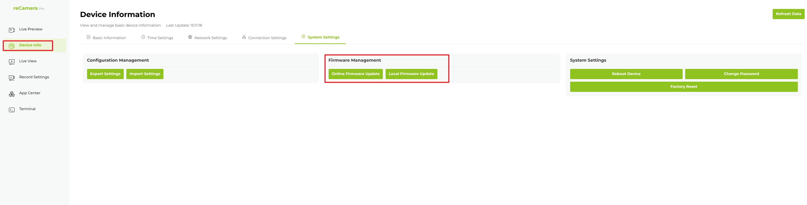
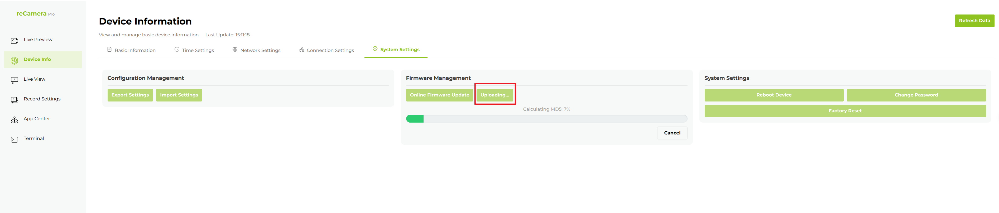
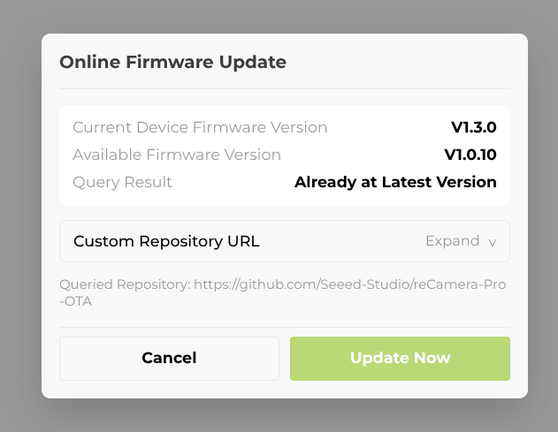
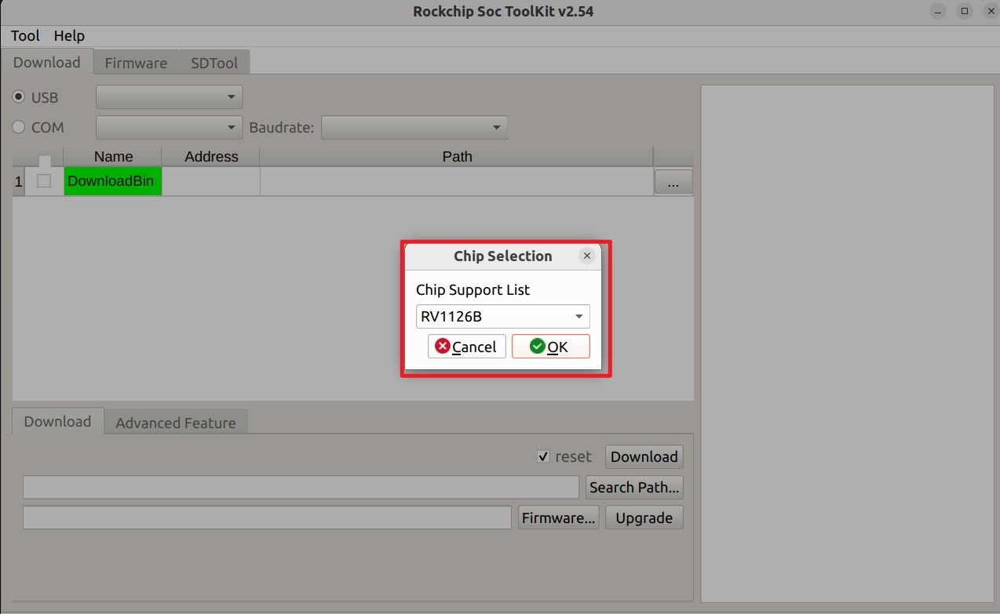
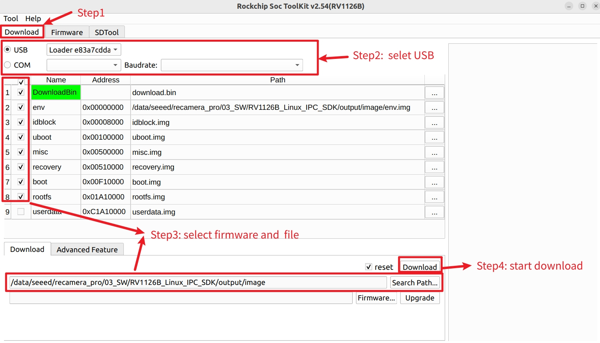

# reCamera Pro — 固件与 OTA 升级

[English](README.md) | **简体中文**

**reCamera Pro** AI 摄像机的官方固件发布与刷写仓库。这里集中提供：OTA 升级包、Web 界面
升级教程、上位机刷写工具，以及一份讲清楚 OTA 在设备上到底怎么做的技术说明。

---

## 目录

1. [认识 reCamera Pro](#1-认识-recamera-pro)
2. [通过 Web 界面升级固件（OTA）](#2-通过-web-界面升级固件ota)
3. [在电脑上刷写整机固件](#3-在电脑上刷写整机固件)
4. [常见问题](#4-常见问题)
5. [链接与支持](#5-链接与支持)

---

## 1. 认识 reCamera Pro


reCamera Pro 是一台基于瑞芯微 **RV1126B** 的**开放式 AI 摄像机**。它运行完整 Linux
系统、自带浏览器 Web 界面、内置 3 TOPS NPU 可做端侧推理，并遵循标准 IP 摄像机协议——
它"不止是人形检测"，而是一台可以部署、扩展和二次开发的边缘 AI 视觉设备。

| 项目 | 规格 |
| --- | --- |
| 处理器 | RV1126B —— 四核 Cortex-A53 @ 1.2 GHz |
| NPU | 3 TOPS（INT8 / INT16 混合） |
| 内存 | LPDDR4 2 GB |
| 存储 | 16 GB eMMC；microSD 最大 512 GB |
| 摄像头 | SC850SL，最高 4K@30 fps |
| 连接 | 千兆以太网（1000 Mbps）、Wi-Fi 5、蓝牙 5.2 |
| 接口 | USB Type-C（OTG）、调试串口、CAN ×2、MIPI DSI、GPIO |
| 供电 | DC 12–24 V（5525 圆孔）、PoE、7.4 V 锂电池 |

**购买链接：** <https://www.seeedstudio.com/reCamera-Pro-2GB.html>

**上手教程（开箱、联网、第一个检测任务、指示灯含义）：**
<https://wiki.seeedstudio.com/recamera_pro_getting_started/>

设备出厂时 Web 界面地址为 `http://192.168.42.1`，首次登录密码是 `recamera`，随后系统会
要求你为 `admin` 账号设置新密码。

---

## 2. 通过 Web 界面升级固件（OTA）

升级有两种方式：**本地升级**（上传自己下载的固件包）和**在线升级**（设备自动到 GitHub
Release 查询新版本）。两者的后续流程完全一致：设备重启进入 recovery 系统，把新固件写入
eMMC，再重启进入新系统，并且**你的数据不会丢失**。

> 第一次接触这台设备？[wiki 上手教程](https://wiki.seeedstudio.com/recamera_pro_getting_started/)
> 介绍了首次登录、联网和 Web 界面的布局。

> **升级前请先做两件事**
>
> - **备份配置。** 在 Web 界面进入 **Device Info → System Settings → 配置管理**，点击
>   **导出设置**，设备会下载一个 `config.tar`（包含各项设置，但刻意排除了密码与设备密钥）。
>   请妥善保存，之后可以用 **导入设置** 恢复。
> - **保持供电稳定。** 升级过程中（状态指示灯约每 100 ms 闪烁一次）不要拔电源、不要断电。
>   写盘期间断电可能让设备无法启动——详见 [§2.3](#23-升级过程中会发生什么) 和
>   [第 4 节](#4-常见问题)。

### 升级入口

浏览器打开设备 Web 界面，进入 **Device Info → System Settings**，找到
**Firmware Management** 卡片。



> 同一页面会显示 **Current Device Firmware Version**（当前固件版本），升级完成后可以在这里
> 确认版本号。

### 2.1 本地升级（上传 `update_ota.tar`）

适用于：固件包已经在电脑上、设备没有外网，或你想安装指定版本。

1. 从[发布页](https://github.com/Seeed-Studio/reCamera-Pro-OTA/releases)下载对应版本的
   `update_ota.tar`。**请保持文件名和后缀不变，不要解压或重新压缩。**
2. 在 Web 界面点击 **Local Firmware Update**，选择该 `update_ota.tar` 文件。
3. 浏览器开始上传（约 1.4 GB）并同时计算 MD5，设备会校验该值。卡片上会显示上传进度和
   `Calculating MD5`：

   

4. 上传完成且校验通过后，设备自动重启进入 recovery 写入固件。**此过程切勿断电。**
   写盘期间状态指示灯约 100 ms 闪烁一次。
5. 写完后设备自动重启进入新固件，到 **Device Info** 确认版本号。

被接受的固件包必须满足：

- 未压缩的 `.tar` 归档（不是 `.tar.gz`），文件名为 `update_ota.tar`；
- 必须包含 `boot.img`、`rootfs.img` 和 `RK_OTA_update.sh`；
- `uboot.img` 可选。

### 2.2 在线升级

适用于设备可以访问互联网的情况。默认查询的官方仓库就是本仓库：
**<https://github.com/Seeed-Studio/reCamera-Pro-OTA>**。

1. 点击 **Online Firmware Update**，设备会查询最新 Release，并显示当前版本、可用版本和查询结果：

   

2. 若有新版本，点击 **Update Now**。设备在后台下载固件包（支持断点续传与自动重试），校验
   通过后重启进 recovery 安装——与本地升级走同一条路径。下载进度在同一卡片显示，也可以取消。
3. 若结果显示 `Already at Latest Version`，说明已是最新版本，无需操作。

**自定义仓库：** 在弹窗中展开 **Custom Repository URL**，可以让设备查询其它 GitHub 仓库
（自研产品、私有构建或测试分支）。该仓库需要通过 GitHub **Releases** 发布，且第一个非校验和
资产必须是合法的 `update_ota.tar`（要求同上）。

### 2.3 升级过程中会发生什么

- 设备会重启两次：第一次进 recovery 写固件，第二次进新系统。
- 整个过程通常几分钟，写盘时指示灯快速闪烁。
- **升级写盘期间请勿断电。** 设备采用单槽设计，没有 A/B 分区、没有自动回滚，固件是原地覆盖
  写入的。若写盘中途掉电，设备**不会**自己回到 recovery：下次上电它会尝试启动分区上现有的
  内容，通常无法启动。但 recovery 系统和升级包都还在——拔掉 USB，**按住 BOOT 键再上电/复位**，
  U-Boot 就会进入 recovery，重新从头执行一次升级（按住 BOOT 时如果插着 USB 线，U-Boot 会进
  rockusb 模式而不是 recovery）。唯一救不回来的是写 `uboot.img` 时断电：它是最后一个写入的镜像，
  引导程序本身可能损坏，此时只能用电脑重刷（第 3 部分）。
- 如果固件包在上传阶段就被拒绝（内容不对或校验失败），设备不会写入任何东西，继续正常运行。
- 如果写盘本身失败，recovery 会中途停止且不重启。请断电重启：若启动到了旧系统，这次启动会删除
  待安装的固件包，需要重新上传；若启动不了，用 BOOT 键重新进入 recovery 再试一次。

### 2.4 数据会被保留

配置、admin 密码与密钥、录像规则、AI 模型、录制的视频和照片全部存放在 **`userdata`**
分区（挂载在 `/userdata`）。OTA 固件包中从不包含 `userdata.img`，升级脚本也只会写入包内
存在同名镜像的分区——因此升级**不会写入、更不会格式化 `userdata`**。
**OTA 之后，配置、录像和照片都会保留。**

只有同页面的 **Factory Reset**（恢复出厂）才会清空 `userdata`，操作前请先备份。

想了解具体写了哪些分区、为什么断电是主要风险？请阅读技术文档：
[docs/OTA_DESIGN_zh.md](docs/OTA_DESIGN_zh.md)。

---

## 3. 在电脑上刷写整机固件

上位机刷写会用你选择的镜像重写启动链与系统分区（bootloader、recovery、内核、rootfs）。适用场景：设备无法
启动、需要干净的出厂状态、需要修改分区布局。日常升级请优先使用第 2 部分的 OTA。

> **刷写前请注意**
>
> - **先备份配置与录像。** 如果设备还能启动，先在 Web 界面导出设置（**Device Info →
>   System Settings → 配置管理 → 导出设置**），并把需要的录像、照片拷出设备。
>   `rkflash.sh all` 会保留 `userdata`，但 `erase` 与恢复出厂会清空它——请一律按
>   "数据可能丢失"来对待。
> - **保持供电，不要拔 USB。** Download 过程中不要拔线、不要断电、不要按 RESET。
>   刷写被中断会留下不完整的固件，只能从头再刷一遍（必要时按住 BOOT 再按 RESET 重新进入
>   boot 模式）。

### 3.1 准备工具

所有刷写工具都在本仓库内，各工具的详细说明见 [tools/README_zh.md](tools/README_zh.md)。

| 平台 | 工具 | 位置 |
| --- | --- | --- |
| Windows | SocToolKit（图形界面） | [`tools/windows/SocToolKit`](tools/windows/SocToolKit) |
| Windows | USB 驱动安装包 | [`tools/windows/DriverAssitant_v5.12.zip`](tools/windows/DriverAssitant_v5.12.zip) |
| Linux | SocToolKit（图形界面） | [`tools/linux/SocToolKit`](tools/linux/SocToolKit) |
| Linux | `upgrade_tool` 命令行 + `rkflash.sh` | [`tools/linux`](tools/linux) |

Windows 下请**先**安装驱动，再把摄像机接入 boot 模式；Linux 下先安装 udev 规则
`tools/linux/SocToolKit/88-rockusb.rules`（步骤见 [tools/README_zh.md](tools/README_zh.md)），
并以 root 运行 SocToolKit。

### 3.2 下载镜像包

从[发布页](https://github.com/Seeed-Studio/reCamera-Pro-OTA/releases)下载对应版本的整机镜像包
并解压，目录结构如下：

```
firmware/
├── download.bin      # Maskrom -> Loader 阶段使用的 loader
├── env.img           # U-Boot 环境变量（含分区表）
├── idblock.img       # loader / DDR 初始化
├── uboot.img         # U-Boot
├── misc.img          # 启动命令块（BCB）
├── recovery.img      # recovery 系统
├── boot.img          # 内核 + 设备树
└── rootfs.img        # 根文件系统
```

> 如果某个版本只发布了 `update_ota.tar`，请改用第 2 部分的 OTA 升级——OTA 包无法救回
> 已经无法启动的设备。

### 3.3 第一步：让设备进入 boot（Loader / Maskrom）模式

1. 用**支持数据传输**的 USB Type-C 线把摄像机连到电脑。
2. 给设备上电。
3. **按住 BOOT 键不放，按一下 RESET 键，然后松开。**

此时设备不会启动 Linux，而是停留在 rockusb 模式，SocToolKit / `upgrade_tool` 会识别到设备。

### 3.4 第二步：打开 SocToolKit，选择芯片

启动 SocToolKit，确认芯片为 **RV1126B**：



如果没有弹出该对话框，可在菜单 **Tool → Chip Selection** 中打开。

### 3.5 第三步：选 USB、选镜像，开始下载

1. 在 **Download** 页选择 **USB**（不是 COM）。
2. 点击 **Search Path…**，选择解压出的镜像文件夹，工具会自动列出镜像。
3. 确认镜像已被勾选（包括 `DownloadBin`），点击 **Download**。

   

> **不要勾选 `userdata.img`。** 如果镜像文件夹里有这个文件，请让 `userdata` 那一行保持
> 不勾选（如上图所示）：`userdata` 是 grow-to-end 分区，存放配置、录像和照片，写入该镜像
> 会把这些数据覆盖掉。官方镜像包中本来也没有它。

工具会把每个镜像写入对应分区，然后重启设备并提示成功。拔掉 USB，等待设备正常启动。

### 3.6 Linux 命令行替代方案

仓库内置的 `rkflash.sh` 封装了 `upgrade_tool`，会先按 `env.img` 里的分区表校验每个偏移，
拒绝不安全的写入：

```bash
cd tools/linux

# 把镜像包内容放到 <仓库根>/firmware，然后：
./rkflash.sh all        # 刷系统分区，保留 misc 与 userdata
./rkflash.sh system     # 等同于 all
./rkflash.sh rd         # 复位已连接的设备
./rkflash.sh loader     # 只升级 loader
./rkflash.sh update /path/to/update.img   # 刷整包 update.img
```

日常使用的 `all` / `system` 会**刻意保留 `misc` 和 `userdata`**，因此录像和配置不会丢。
其它用法：

```bash
RKFLASH_DRY_RUN=1 ./rkflash.sh all          # 只校验并打印命令，不碰设备
RKFLASH_IMAGE_DIR=/path/to/firmware ./rkflash.sh all
./rkflash.sh factory-reset                  # 写入恢复出厂标志，下次启动清空 userdata
./rkflash.sh erase I-UNDERSTAND-THIS-ERASES-THE-DEVICE   # 擦除整块设备
```

> `erase` 与 `factory-reset` 会销毁数据，确认无误后再使用。

### 3.7 刷写完成后

设备会自动重启并启动出厂固件。打开 Web 界面（首次开机为 `http://192.168.42.1`），
用初始密码 `recamera` 登录，然后为 `admin` 设置新密码。

---

## 4. 常见问题

| 现象 | 排查方向 |
| --- | --- |
| SocToolKit / `upgrade_tool` 识别不到设备 | Windows 装 USB 驱动、Linux 装 udev 规则；换一根支持数据的线；重新进入 boot 模式（按住 BOOT → 按 RESET） |
| 刷机后打不开 Web 界面 | 确认电脑与设备在同一网段；首次开机地址是 `http://192.168.42.1`；等指示灯不再呼吸（启动完成） |
| OTA 上传中断或失败 | 检查 `userdata` 剩余空间——固件包约 1.4 GB，上传和解包需要大约两倍空间；清理旧录像 |
| 在线升级提示无法访问仓库 | 设备需要外网；GitHub 对匿名 API 查询可能限流，稍后重试，或改用本地升级 |
| 提示升级完成但版本号没变 | 固件包在下发前就被拒绝了（内容或校验不对）；确认包含 `boot.img`、`rootfs.img`、`RK_OTA_update.sh` 后重试 |
| 升级过程中断电 | 按住 BOOT 键（不插 USB 线）重新上电：U-Boot 会进入 recovery，由于 `update_ota.tar` 仍在 `userdata` 中，升级会从头再跑一遍。若断电发生在写 `uboot.img` 时，只能用电脑重刷（第 3 部分） |
| 指示灯一直闪、设备迟迟不回来 | recovery 在写盘阶段停止且不会自动重启。断电重启；若启动不了，按住 BOOT（不插 USB）重新进入 recovery 重试同一个包；仍失败则用电脑重刷（第 3 部分） |

指示灯含义（来自 wiki）：呼吸 = 启动中，常亮 = 正常，熄灭 = 核心进程异常，
**100 ms 闪烁 = 正在 OTA 升级**。

---

## 5. 链接与支持

- 产品页面：<https://www.seeedstudio.com/reCamera-Pro-2GB.html>
- Wiki 文档：<https://wiki.seeedstudio.com/recamera_pro_getting_started/>
- 硬件规格：<https://wiki.seeedstudio.com/recamera_pro_hardware_specifications/>
- 固件发布页：<https://github.com/Seeed-Studio/reCamera-Pro-OTA/releases>
- OTA 技术文档：[docs/OTA_DESIGN_zh.md](docs/OTA_DESIGN_zh.md) · [English](docs/OTA_DESIGN.md)

### 仓库结构

```
.
├── images/     # 文档使用的截图
├── docs/       # OTA 技术文档（分区图、升级时序、风险点）
└── tools/      # Linux 与 Windows 的瑞芯微刷写工具
```

### 第三方工具说明

SocToolKit、`upgrade_tool`、`afptool`、`rkImageMaker` 及 USB 驱动均为**瑞芯微（Rockchip）**
官方工具，本仓库仅为方便用户而原样分发，版权归 Rockchip 所有；各工具目录内的
`license.txt` / `revison.log` 为原始版权与版本说明。

固件镜像与升级包由 Seeed Studio 为 reCamera Pro 提供。