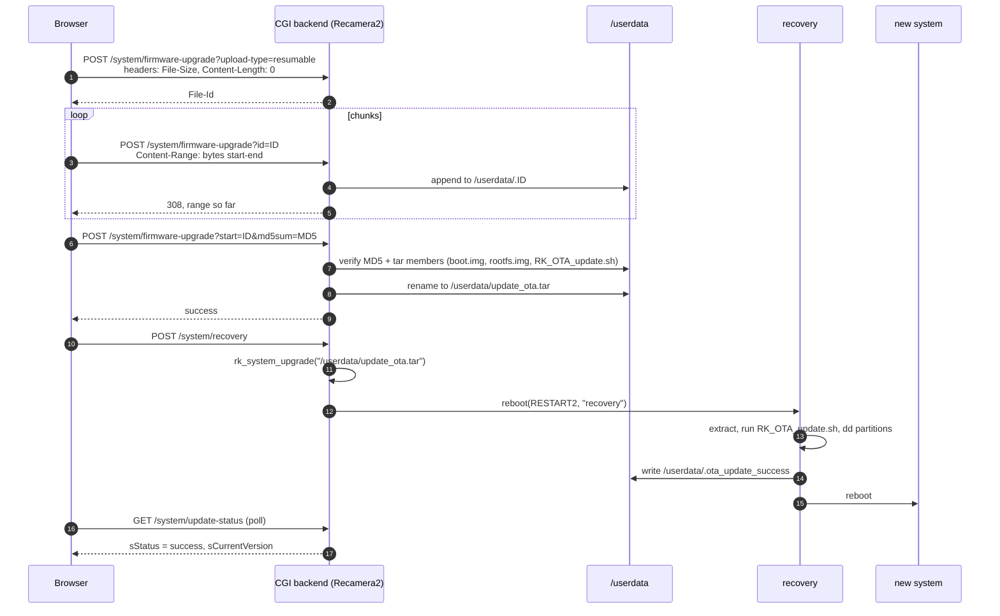
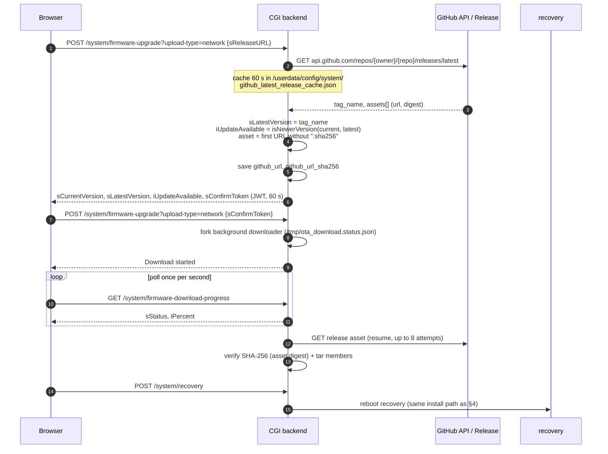

# reCamera Pro OTA — Design Note

**English** | [简体中文](OTA_DESIGN_zh.md)

This note explains **how firmware updates actually work** on the reCamera Pro
(RV1126B, eMMC, single slot): the partition layout, the update package, both update
paths (local upload and online from GitHub Releases), the recovery-side installer, and
the risks you should understand before deploying devices in the field.

It describes the shipped implementation, not an idealised one. File paths refer to the
RV1126B Linux IPC SDK sources so that you can audit every step.

---

## 1. System overview

```
 Browser (Web UI)
   │  HTTP  /cgi-bin/entry.cgi/system/...
   ▼
 Recamera2 (CGI backend)  ── local socket ──►  rkipc
   │                                            │ rk_system_upgrade()
   │                                            └─ reboot(RESTART2, "recovery")
   ▼                                                    │
 /userdata/update_ota.tar                               │
   │                                                    ▼
   └────────────────────────►  recovery partition (tiny initramfs)
                                  RkLunch.sh → RK_OTA_update.sh → dd to partitions
                                        │
                                        ├─ write /userdata/.ota_update_success
                                        └─ reboot → normal system (new firmware)
```

Key properties of this design:

| Property | Value |
| --- | --- |
| Slot scheme | **Single slot** — no A/B, no automatic rollback |
| Installer | recovery partition (`recovery.img`, 10 MiB, never updated by OTA) |
| Written by OTA | only the partitions present as `<name>.img` in the package (`uboot`, `boot`, `rootfs`) |
| Preserved | `env`, `idblock`, `recovery`, `misc` (except a 32-byte BCB clear), `userdata` |
| Transfer | local: HTTP chunked upload to `/userdata`; online: GitHub Release asset download |

---

## 2. Partition layout

The partition table is **not** a `parameter.txt` on this SDK. It is generated into the
U-Boot environment image and consumed by the kernel through `blkdevparts`:

```
blkdevparts=mmcblk0:32K(env),512K@32K(idblock),4M@1M(uboot),64K(misc),
                     10M(recovery),11M(boot),3G(rootfs),-(userdata),
```

Authoritative source: `project/cfg/BoardConfig_Recamera2/BoardConfig-EMMC-RK801-RV1126B_V1-IPC_64BIT.mk`
(`RK_PARTITION_CMD_IN_ENV`); the same string is embedded in `output/image/env.img`.
`/dev/block/by-name/<name>` symlinks are created by `S20linkmount` (normal system) and
`S15linkmount_recovery` (recovery).

### 2.1 Map

```
 byte offset 0
 ┌──────────────────────────────┐
 │ env            32 KiB        │  p1   U-Boot environment (partition table, bootargs)
 ├──────────────────────────────┤ 0x8000
 │ idblock       512 KiB        │  p2   loader / DDR init  (Maskrom → Loader)
 ├──────────────────────────────┤ 0x88000
 │ reserved      480 KiB        │       eMMC vendor storage (SN, calibration)
 ├──────────────────────────────┤ 0x100000  (1 MiB alignment, see board config comment)
 │ uboot           4 MiB        │  p3   U-Boot
 ├──────────────────────────────┤ 0x500000
 │ misc           64 KiB        │  p4   Android BCB + factory-reset flag
 ├──────────────────────────────┤ 0x510000
 │ recovery       10 MiB        │  p5   recovery kernel + initramfs (the OTA installer)
 ├──────────────────────────────┤ 0xF10000
 │ boot           11 MiB        │  p6   kernel + device tree (+ overlays)
 ├──────────────────────────────┤ 0x1A10000
 │ rootfs          3 GiB        │  p7   ext4 root filesystem (/oem lives inside it)
 ├──────────────────────────────┤ 0xC1A10000
 │ userdata     rest of eMMC    │  p8   ext4, mounted /userdata — config, recordings, photos
 └──────────────────────────────┘ end of eMMC
```

### 2.2 Table

| # | Partition | Offset | Size | Content | Written by OTA? |
| --- | --- | --- | --- | --- | --- |
| p1 | `env` | `0x00000000` | 32 KiB | U-Boot env, contains `blkdevparts` and `bootargs` | no |
| p2 | `idblock` | `0x00008000` | 512 KiB | loader / DDR init | no |
| — | *(reserved)* | `0x00088000` | 480 KiB | eMMC vendor storage (SN, calibration) | no |
| p3 | `uboot` | `0x00100000` | 4 MiB | U-Boot | **yes** (if `uboot.img` is in the package) |
| p4 | `misc` | `0x00500000` | 64 KiB | BCB at `0x4000`, factory-reset flag at `0x1800` | only a 32-byte BCB clear |
| p5 | `recovery` | `0x00510000` | 10 MiB | recovery kernel + initramfs | **no** — never overwritten by OTA |
| p6 | `boot` | `0x00F10000` | 11 MiB | kernel + DTB + overlays | **yes** |
| p7 | `rootfs` | `0x01A10000` | 3 GiB | ext4 root filesystem (`/oem` is a directory inside it) | **yes** |
| p8 | `userdata` | `0xC1A10000` | grow to end | ext4: `/userdata` | **no** |

### 2.3 Why single slot

The design trades “instant rollback” for simplicity and flash space:

- 3 GiB rootfs × 2 plus a duplicated boot partition would not fit comfortably on a
  16 GB eMMC together with user recordings.
- The recovery partition gives a *re-flash* path, but **not** a *rollback* path: once
  `rootfs` is overwritten, the old system is gone. Recovery stays intact, so you can always
  boot into it and redo the write — an OTA retry is idempotent, see
  [§6.1](#61-power-loss-and-retrying-an-update) — or rewrite partitions over USB / from an
  SD card, but there is no “boot the previous version” option.

Consequences are covered in [§8 Risks](#8-risks-and-mitigations).

---

## 3. Version and package format

### 3.1 Where the version comes from

- Build-time: `RK_OTA_VERSION=V1.3.1` in the board config.
- Image build writes it to `/etc/ota_version` inside the root filesystem
  (`project/build.sh`).
- The device reports it through `GET /system/device-info` → `sFirmwareVersion`
  (`system_api.cpp`, `GetCurrentVersion()` reads the first line of `/etc/ota_version`)
  and through `GET /system/update-status` → `sCurrentVersion`.
- The online path compares this string against the GitHub release `tag_name`
  (`isNewerVersion()`: strip a leading `v`/`V`, compare numeric segments).

There is no build timestamp, no build metadata and no signature inside the version
string. Two images with the same `RK_OTA_VERSION` are indistinguishable.

### 3.2 Package contents

`update_ota.tar` is an **uncompressed, unsigned** tar produced by `./build.sh ota`
(`build_ota()` in `project/build.sh`):

```
update_ota.tar
├── uboot.img            # optional — controlled by RK_OTA_RESOURCE
├── boot.img             # required
├── rootfs.img           # required
└── RK_OTA_update.sh     # required — the installer script (executable)
```

- Members come from `RK_OTA_RESOURCE` (`"uboot.img boot.img rootfs.img"` for the current
  IPC 64-bit config; some earlier releases shipped only `boot.img rootfs.img`).
- The CGI backend rejects packages that do not contain `boot.img`, `rootfs.img` and
  `RK_OTA_update.sh`; `uboot.img` is not required.
- There is **no** `recovery.img`, `misc.img`, `env.img`, `idblock.img` or
  `userdata.img`.
- Typical size: ~1.4 GB (rootfs dominates).

> The installer writes **any** partition that has a matching `<name>.img`. A package
> containing `userdata.img` or `env.img` would therefore overwrite those partitions too.
> Only flash packages you got from the official release page.

---

## 4. Local update (upload from the browser)

The package never leaves your network: the browser uploads it into `/userdata`, the
device verifies it, then reboots into recovery.



Details worth knowing:

- The upload is chunked and resumable; the backend reserves `file_size + 10 MB` of free
  space before accepting it.
- The MD5 is supplied **by the browser**. It proves transport integrity between browser
  and device, not authenticity.
- After a successful dispatch the HTTP response may never arrive — the device reboots
  while answering. The Web UI treats a dropped connection as “unknown” and then verifies
  by polling the version and the boot time.
- The final POST `/system/recovery` does not check the `rk_system_upgrade()` result; it
  always answers success if it is still running.

---

## 5. Online update (query GitHub Releases)

The default repository is **`https://github.com/Seeed-Studio/reCamera-Pro-OTA`** (this
repository). The URL is stored per device in `/userdata/config/system/github_url` after a
query, so a custom repository survives reboots until changed in the UI.



Details worth knowing:

- Asset selection has **no filename filter**: the backend takes the first asset URL that
  does not contain `.sha256` or `sha256sum`. Keep a single, stable asset name
  (`update_ota.tar`) in every release.
- Integrity uses the asset's `digest` field (`sha256:...`) written by GitHub. If a release
  asset has no digest, the device reports `sha256_download_error` and deletes the file —
  so uploaded assets should always be published through the GitHub release UI/API that
  computes digests.
- Download is resumable and retried (HTTP 408/429/5xx and curl timeouts, exponential
  backoff capped at 60 s).
- GitHub API is queried **anonymously** (a token file exists in the code but is unused),
  so a 60-per-hour-per-IP rate limit applies on shared/NAT networks; the UI shows a
  rate-limit message when GitHub answers 403.
- TLS certificate verification is disabled for both the API call and the download
  (`CURLOPT_SSL_VERIFYPEER/HOST = 0`) — acceptable for public read-only assets, but it
  means a network attacker could serve different content. The SHA-256 check from the API
  response does not protect against this (the digest comes over the same unverified
  channel).

---

## 6. How recovery installs the package

Boot selection:

1. `POST /system/recovery` → `rk_system_upgrade()` (`recamera_ipc/common/system/system.c`)
   calls `sync()` then `reboot(LINUX_REBOOT_CMD_RESTART2, "recovery")`.
2. The SoC's `syscon-reboot-mode` register (`rv1126b.dtsi`, `mode-recovery`) is read by
   U-Boot, which boots the `recovery` partition.
3. As a fallback, U-Boot also honours an Android BCB `boot-recovery` command at offset
   `0x4000` of the `misc` partition (`BCB_MESSAGE_BLK_OFFSET = 16 KiB`).

Recovery itself is a minimal initramfs:

- `S15linkmount_recovery` creates `/dev/block/by-name/*` and mounts **only** `userdata`
  (`RECOVERY_MOUNT_ONLY=1`).
- `S99lunch_recovery` runs `RkLunch.sh`, which is
  `project/scripts/RkLunch-recovery.sh`.

`RkLunch-recovery.sh`:

1. starts the blink loop on GPIO 226 (status LED, ~100 ms) so the user can see progress;
2. clears `/userdata/.ota_update_success` from any previous run;
3. looks for the package in this order:
   `/userdata/update_ota.tar` → SD card (`mmcblk1`/`mmcblk2`, `update_ota.tar` in the
   root of a FAT partition);
4. extracts it to `/userdata/update` (or `<sdcard>/update`);
5. runs `RK_OTA_update.sh`;
6. on success: writes `/userdata/.ota_update_success`, removes the extracted directory,
   `reboot`;
7. on failure: removes the extracted directory and exits — it does **not** reboot, so the
   device stays in recovery with the LED still blinking and has to be power-cycled. If no
   package is found at all, it calls `/usr/bin/RK_OTA_erase_misc.sh` and reboots, which
   returns the device to the system it had before.

`RK_OTA_update.sh` (inside the package) is deliberately trivial:

```sh
for image in $(ls /dev/block/by-name); do
    if [ -f "$COMMON_DIR/${image}.img" ]; then
        dd if="$COMMON_DIR/${image}.img" of=/dev/block/by-name/$image
    fi
done
dd if=/dev/zero of=/dev/block/by-name/misc bs=32 count=1 seek=512   # clear BCB at 0x4000
```

Notes:

- `COMMON_DIR` is the extracted directory (`/userdata/update`); `dd` writes raw images
  with no seek — the image is written to the start of the partition.
- Only partitions that exist in `/dev/block/by-name` **and** have a matching `.img` are
  touched. For the shipped package that is `uboot`, `boot`, `rootfs`.
- Clearing `misc` at 0x4000 removes the recovery command, so the next boot goes to the
  normal system.
- `recovery` is never in the package, so the installer itself cannot be updated over the
  air. Bug fixes in the installer require a PC reflash.

### 6.1 Power loss, and retrying an update

Writing the 3 GiB `rootfs` takes minutes, so a power cut is the realistic failure mode.
Here is exactly what the design does and does not do:

- **The recovery request is volatile.** `rk_system_upgrade()` only issues
  `reboot(RESTART2, "recovery")`, which programs the SoC reboot-mode register
  (`syscon-reboot-mode`). Nothing is written to `misc` before the update starts. After a
  power cut the register is back at its reset value, so the next boot is a **normal** boot
  of whatever now sits on `boot`/`rootfs` — half-written or not. There is no boot counter,
  no fallback when the kernel fails and no automatic retry.
- **Recovery itself is intact.** It lives in its own 10 MiB partition, is never written by
  OTA, and boots independently of `rootfs`.
- **The package is intact.** `update_ota.tar` stays in `/userdata` for the whole update; only
  the normal system's `RkLunch.sh` deletes it, and only once the normal system has started.
- **Recovery can be entered by hand.** U-Boot's `setup_download_mode()` samples the download
  key (the BOOT button, `adc-keys` in `rv1126b-recamera2.dts`): key pressed **without** USB
  VBUS sets `reboot_mode=recovery-key` and boots the recovery partition, while the same key
  **with** a USB cable attached enters rockusb instead. So: unplug USB, hold BOOT,
  power-cycle → recovery.
- **Retrying is safe.** `RkLunch-recovery.sh` deletes the extraction directory when it
  fails and extracts again on the next run, and `RK_OTA_update.sh` rewrites every image
  present in the package — a retry simply redoes the whole update from the beginning.
  If `userdata` itself became unusable, put `update_ota.tar` in the root of a FAT SD card:
  the recovery script scans `mmcblk1`/`mmcblk2` as well.

The narrow unrecoverable case is the **`uboot.img` write**. `RK_OTA_update.sh` iterates
`ls /dev/block/by-name` (alphabetical), so the order is `boot` → `rootfs` → `uboot`: the
bootloader is written last. A cut inside that window can corrupt U-Boot, and then the BOOT
key is never processed — there is no U-Boot left to read it. Such a device must be
reflashed from a PC, exactly like any other broken bootloader.

---

## 7. Integrity and trust chain

| Stage | Check | Strength |
| --- | --- | --- |
| Browser → device (local) | MD5 computed in the browser, verified by the backend | detects corruption, *not* tampering |
| GitHub → device (online) | SHA-256 from the release asset `digest` | strong if GitHub is honest/reachable; digest comes over an unverified TLS channel |
| Before dispatch | tar contains `boot.img`, `rootfs.img`, `RK_OTA_update.sh` | catches wrong/truncated packages |
| Recovery write | none — `dd` writes whatever is inside the tar | no verification at all |

There is **no image signature**, no key pinning and no rollback counter. Anyone who can
serve a package to the device (or upload one through an authenticated session) can
replace the firmware. Treat Web UI credentials as root credentials.

---

## 8. Risks and mitigations

| # | Risk | What happens | Mitigation |
| --- | --- | --- | --- |
| 1 | **Power loss during `dd`** | `boot`/`rootfs` partially written → the device no longer boots. No A/B slot, no automatic rollback, and the recovery request was only a volatile register, so there is no automatic retry either. The recovery partition and `/userdata/update_ota.tar` survive, so a manual boot into recovery re-runs the update. If the cut falls inside the last image (`uboot.img`), U-Boot itself can be corrupt and the BOOT key no longer works. | Prefer a UPS or PoE with backup; do not update on an unstable supply. If it happens: unplug USB, hold BOOT, power-cycle → recovery redoes the package. Keep a PC + full image set for the broken-bootloader case. |
| 2 | **No signature** | A tampered `update_ota.tar` is applied without complaint. | Only use official releases; verify the SHA-256 published in the release yourself; restrict Web UI access. |
| 3 | **Recovery is never updated** | Every device keeps the installer from its factory image; a future package format change may not be understood by old devices. | Keep `RK_OTA_update.sh` backward compatible; document minimum firmware for new package layouts. |
| 4 | **`/userdata` free space** | Package ~1.4 GB must be stored, then extracted (≈2.8 GB peak) in `/userdata`. Old recordings can fill the partition. | Check free space before updating; delete recordings; the UI reserves `size + 10 MB` but extraction needs more. |
| 5 | **rootfs grows over 3 GiB** | New images no longer fit → `dd` fails or truncates. | Watch `rootfs.img` size in CI; partition changes require a PC reflash with a new partition table. |
| 6 | **Online check rate-limited** | Anonymous GitHub API 403 on shared NAT / field networks → “cannot reach repository”. | Retry later, use a custom mirror repository, or use the local update. |
| 7 | **TLS verification disabled** | A MITM can serve a different asset; the SHA-256 digest travels the same channel. | Prefer local updates on untrusted networks; pin a mirror you control. |
| 8 | **Package contains `userdata.img`/`env.img`** | The installer would `dd` them onto those partitions (userdata is even mounted at the time). | Never ship such packages; only flash official packages. |
| 9 | **`/userdata/update_ota.tar` is auto-deleted** | The normal system’s `RkLunch.sh` removes a leftover package on boot. | Re-upload for a retry; keep a local copy of the package. |
| 10 | **Duplicate version strings** | Two different builds with the same `RK_OTA_VERSION` look identical; “already latest” may be wrong. | Bump `RK_OTA_VERSION` for every published build (release skill does this). |
| 11 | **Factory reset is a separate mechanism** | `Factory Reset` writes a flag into `misc` (`cmd_wipe_userdata` at `0x1800`); the next normal boot formats `userdata`. It is not part of OTA. | Back up before using it; `rkflash.sh factory-reset` exposes the same flag. |

---

## 9. Data preservation

`userdata` is never touched by an update:

- the package has no `userdata.img`;
- the installer only writes partitions that have an image in the package;
- recovery mounts `/userdata` read-write only to read the package, extract it, write the
  success flag and clean up.

So after OTA you keep: configuration (`rkipc.ini`, network, recording rules), Web
credentials and keys, AI models, FTP home, SenseCraft session state, recordings and
photos.

Preserved on **every** update: `env`, `idblock`, `recovery`, `userdata`, and the factory
reset flag area of `misc`.

Lost on **Factory Reset** only: the contents of `userdata`.

---

## 10. Building and publishing a release

```bash
# in the SDK, after a full or app build
cd project
./build.sh ota                 # -> output/image/update_ota.tar

# the version comes from the board config
grep RK_OTA_VERSION cfg/BoardConfig_Recamera2/BoardConfig-EMMC-RK801-RV1126B_V1-IPC_64BIT.mk
```

Publishing checklist:

1. bump `RK_OTA_VERSION` (and the manifest lock) in the SDK;
2. build `update_ota.tar` and, for PC flashing, the full image set
   (`download.bin`, `env.img`, `idblock.img`, `uboot.img`, `misc.img`, `recovery.img`,
   `boot.img`, `rootfs.img`);
3. create a GitHub Release in this repository with the tag matching `RK_OTA_VERSION`
   (`V1.3.1`, uppercase `V`), upload `update_ota.tar` as an asset;
4. keep the asset name exactly `update_ota.tar` and keep it the **first non-checksum**
   asset — the device does not filter by name;
5. test the online path on a real device: the dialog must show the new `tag_name` and
   successfully download and verify it.

> Tag naming matters: the UI compares `tag_name` numerically, but older releases used
> both `1.1.0` and `V1.0.10`. Use the `Vx.y.z` form consistently.

---

## 11. Diagnosing an update

| What | Where |
| --- | --- |
| Current firmware version | `cat /etc/ota_version`; or Web UI → Device Info |
| Last update result | `ls /userdata/.ota_update_success` (written only on success) |
| Staged package | `/userdata/update_ota.tar` (removed on the next normal boot) |
| Online download state | `/tmp/ota_download_status.json`, PID `/tmp/ota_download.pid` |
| Release cache | `/userdata/config/system/github_latest_release_cache.json` (60 s) |
| Repository URL used | `/userdata/config/system/github_url`, `github_url_sha256` |
| Recovery console | USB/UART console during the update; `RkLunch.sh` prints each step |

Common outcomes:

| Message / state | Meaning |
| --- | --- |
| `Already at Latest Version` | `isNewerVersion(current, tag_name)` is false |
| `sha256_download_error` | release asset has no digest, or the stored digest is stale |
| `The file is inaccurate, and critical files are missing inside the tar.` | package lacks `boot.img`, `rootfs.img` or `RK_OTA_update.sh` |
| Update ran but version unchanged | package rejected before dispatch (bad contents/checksum); or the device was power-cycled after a failed write and still runs the old partitions |
| Device does not boot after a power cut | Unplug USB, hold BOOT, power-cycle → recovery, which re-runs `/userdata/update_ota.tar` from the start (see [§6.1](#61-power-loss-and-retrying-an-update)) |

---

## Appendix — source of truth in the SDK

| Topic | File |
| --- | --- |
| Partition layout, OTA resource list, version | `project/cfg/BoardConfig_Recamera2/BoardConfig-EMMC-RK801-RV1126B_V1-IPC_64BIT.mk` |
| OTA package generation | `project/build.sh` (`build_ota`) |
| Recovery-side installer | `project/scripts/RkLunch-recovery.sh` |
| Recovery extraction script | `output/out/ramdisk/tiny_rootfs/usr/bin/RK_OTA_erase_misc.sh` |
| In-package writer | generated `RK_OTA_update.sh` |
| Reboot into recovery | `project/app/recamera_ipc/common/system/system.c` (`rk_system_upgrade`) |
| Web API | `project/app/recamera_web/recamera_web_backend/src/system_api.cpp` |
| Web UI | `project/app/recamera_web/recamera_web_react/src/components/device_info/SystemInfo.js` |