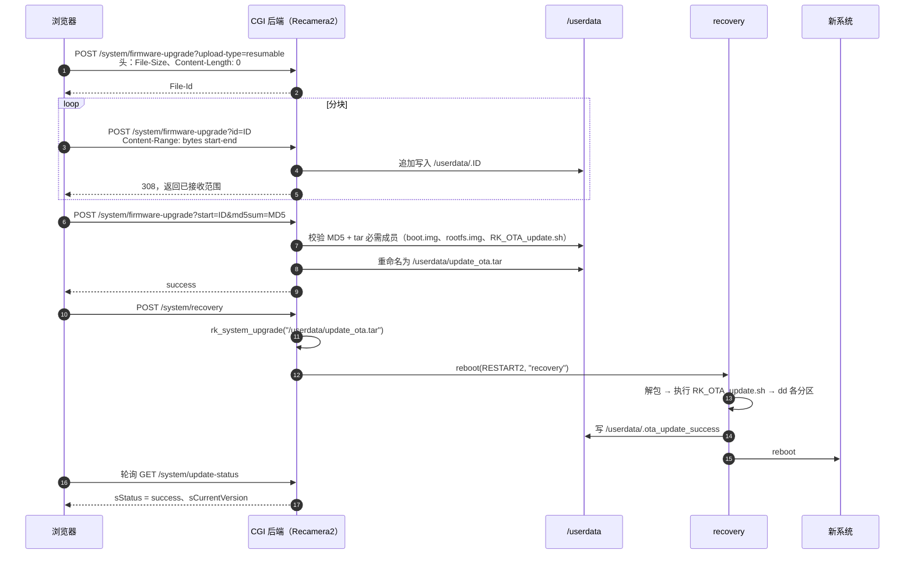
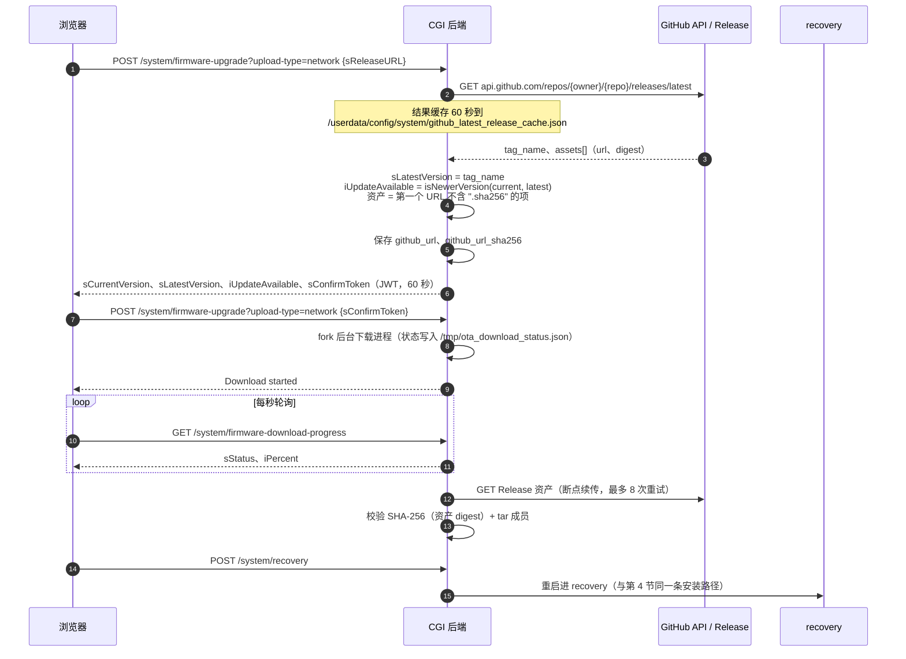

# reCamera Pro OTA 技术说明

[English](OTA_DESIGN.md) | **简体中文**

本文说明 reCamera Pro（RV1126B，eMMC，单槽）固件升级的**真实实现**：分区布局、升级包格式、
两条升级路径（本地上传 / GitHub Releases 在线升级）、recovery 端的安装过程，以及量产部署
前必须理解的风险点。

文中的文件路径均指向 RV1126B Linux IPC SDK 源码，方便你逐步核对。

---

## 1. 系统总览

```
 浏览器（Web UI）
   │  HTTP  /cgi-bin/entry.cgi/system/...
   ▼
 Recamera2（CGI 后端） ── 本地 socket ──►  rkipc
   │                                        │ rk_system_upgrade()
   │                                        └─ reboot(RESTART2, "recovery")
   ▼                                                 │
 /userdata/update_ota.tar                            │
   │                                                 ▼
   └──────────────────────►  recovery 分区（tiny initramfs）
                               RkLunch.sh → RK_OTA_update.sh → dd 写各分区
                                     │
                                     ├─ 写 /userdata/.ota_update_success
                                     └─ reboot → 正常系统（新固件）
```

这套设计的关键属性：

| 属性 | 取值 |
| --- | --- |
| 槽位方案 | **单槽**——没有 A/B，没有自动回滚 |
| 安装器 | recovery 分区（`recovery.img`，10 MiB，OTA 永不更新它） |
| OTA 写入的分区 | 仅包内存在 `<name>.img` 的分区（`uboot`、`boot`、`rootfs`） |
| 保持不变的分区 | `env`、`idblock`、`recovery`、`misc`（仅清 32 字节 BCB）、`userdata` |
| 传输方式 | 本地：分块 HTTP 上传到 `/userdata`；在线：从 GitHub Release 资产下载 |

---

## 2. 分区布局

本 SDK **没有** `parameter.txt`。分区表在构建时被写入 U-Boot 环境镜像，内核通过
`blkdevparts` 获取：

```
blkdevparts=mmcblk0:32K(env),512K@32K(idblock),4M@1M(uboot),64K(misc),
                     10M(recovery),11M(boot),3G(rootfs),-(userdata),
```

权威定义：`project/cfg/BoardConfig_Recamera2/BoardConfig-EMMC-RK801-RV1126B_V1-IPC_64BIT.mk`
中的 `RK_PARTITION_CMD_IN_ENV`；同样的字符串也嵌在 `output/image/env.img` 里。
`/dev/block/by-name/<name>` 软链由 `S20linkmount`（正常系统）与 `S15linkmount_recovery`
（recovery）创建。

### 2.1 分区图

```
 字节偏移 0
 ┌──────────────────────────────┐
 │ env            32 KiB        │  p1   U-Boot 环境（分区表、bootargs）
 ├──────────────────────────────┤ 0x8000
 │ idblock       512 KiB        │  p2   loader / DDR 初始化（Maskrom → Loader）
 ├──────────────────────────────┤ 0x88000
 │ 保留          480 KiB        │       eMMC vendor storage（SN、校准数据）
 ├──────────────────────────────┤ 0x100000（1 MiB 对齐，见板级配置注释）
 │ uboot           4 MiB        │  p3   U-Boot
 ├──────────────────────────────┤ 0x500000
 │ misc           64 KiB        │  p4   Android BCB + 恢复出厂标志
 ├──────────────────────────────┤ 0x510000
 │ recovery       10 MiB        │  p5   recovery 内核 + initramfs（OTA 安装器）
 ├──────────────────────────────┤ 0xF10000
 │ boot           11 MiB        │  p6   内核 + 设备树（含 overlay）
 ├──────────────────────────────┤ 0x1A10000
 │ rootfs          3 GiB        │  p7   ext4 根文件系统（/oem 是其内部目录）
 ├──────────────────────────────┤ 0xC1A10000
 │ userdata     eMMC 剩余空间   │  p8   ext4，挂载 /userdata——配置、录像、照片
 └──────────────────────────────┘ eMMC 末尾
```

### 2.2 分区表

| # | 分区 | 偏移 | 大小 | 内容 | OTA 是否写入 |
| --- | --- | --- | --- | --- | --- |
| p1 | `env` | `0x00000000` | 32 KiB | U-Boot 环境，含 `blkdevparts` 与 `bootargs` | 否 |
| p2 | `idblock` | `0x00008000` | 512 KiB | loader / DDR 初始化 | 否 |
| — | *保留* | `0x00088000` | 480 KiB | eMMC vendor storage（SN、校准） | 否 |
| p3 | `uboot` | `0x00100000` | 4 MiB | U-Boot | **是**（包内有 `uboot.img` 时） |
| p4 | `misc` | `0x00500000` | 64 KiB | `0x4000` 处为 BCB，`0x1800` 处为恢复出厂标志 | 仅清 32 字节 BCB |
| p5 | `recovery` | `0x00510000` | 10 MiB | recovery 内核 + initramfs | **否**——OTA 永不覆盖 |
| p6 | `boot` | `0x00F10000` | 11 MiB | 内核 + DTB + overlay | **是** |
| p7 | `rootfs` | `0x01A10000` | 3 GiB | ext4 根文件系统（`/oem` 在其内部） | **是** |
| p8 | `userdata` | `0xC1A10000` | 剩余空间 | ext4：`/userdata` | **否** |

### 2.3 为什么是单槽

这是在"即时回滚"与"简单 + 空间"之间做的取舍：

- 3 GiB rootfs 做双份、再复制一份 boot，在 16 GB eMMC 上还要留给用户录像，空间不够；
- recovery 分区提供了**重刷**通道，但不是**回滚**通道：`rootfs` 一旦被覆盖，旧系统就没了。
  recovery 本身完好，所以随时可以进 recovery 重新写一遍（重跑 OTA 是幂等的，见
  [§6.1](#61-断电与重试)），或者通过 USB / SD 卡重写分区，但没有"启动上一个版本"这个选项。

由此带来的后果见[第 8 节 风险](#8-风险与规避)。

---

## 3. 版本号与升级包格式

### 3.1 版本号从哪来

- 构建时：板级配置中的 `RK_OTA_VERSION=V1.3.1`；
- 打镜像时写入根文件系统的 `/etc/ota_version`（`project/build.sh`）；
- 设备通过 `GET /system/device-info` 的 `sFirmwareVersion` 上报
  （`system_api.cpp` 的 `GetCurrentVersion()` 读取 `/etc/ota_version` 第一行），
  `GET /system/update-status` 的 `sCurrentVersion` 同样来自该文件；
- 在线升级拿它与 GitHub Release 的 `tag_name` 比较（`isNewerVersion()`：去掉前缀
  `v`/`V`，按数字段比较）。

版本串里没有构建时间、没有构建元数据、也没有签名。两个 `RK_OTA_VERSION` 相同的镜像
无法区分。

### 3.2 升级包内容

`update_ota.tar` 是 `./build.sh ota`（`project/build.sh` 的 `build_ota()`）生成的
**未压缩、无签名** tar 包：

```
update_ota.tar
├── uboot.img            # 可选——由 RK_OTA_RESOURCE 决定
├── boot.img             # 必需
├── rootfs.img           # 必需
└── RK_OTA_update.sh     # 必需——安装脚本（可执行）
```

- 成员由 `RK_OTA_RESOURCE` 决定（当前 IPC 64 位配置为
  `"uboot.img boot.img rootfs.img"`；部分早期版本只有 `boot.img rootfs.img`）。
- CGI 后端会拒绝缺少 `boot.img`、`rootfs.img`、`RK_OTA_update.sh` 的包；`uboot.img` 非必需。
- 包里**没有** `recovery.img`、`misc.img`、`env.img`、`idblock.img`、`userdata.img`。
- 典型大小约 1.4 GB（主要是 rootfs）。

> 安装脚本会写入**任何**存在同名 `<name>.img` 的分区。因此包含 `userdata.img` 或
> `env.img` 的包同样会覆盖这些分区。**只刷官方发布页的固件包。**

---

## 4. 本地升级（浏览器上传）

固件包不出局域网：浏览器把包上传到 `/userdata`，设备校验后重启进 recovery。



值得注意的细节：

- 上传是分块、可续传的；后端在接受前会预留 `文件大小 + 10 MB` 的剩余空间。
- MD5 是**浏览器**算好上传的，只能证明"浏览器→设备"传输完整，不代表来源可信。
- 下发重启后 HTTP 响应可能永远收不到——设备在应答过程中就重启了。Web UI 把连接中断当作
  "结果未知"，随后通过轮询版本号和启动时间来判断。
- 最后的 `POST /system/recovery` 不检查 `rk_system_upgrade()` 的返回值；只要进程还在，
  它就返回成功。

---

## 5. 在线升级（查询 GitHub Releases）

默认仓库是 **`https://github.com/Seeed-Studio/reCamera-Pro-OTA`**（即本仓库）。查询后 URL 会
存到设备的 `/userdata/config/system/github_url`，因此自定义仓库在重启后仍然生效，直到
在界面上再次修改。



值得注意的细节：

- 资产选择**没有文件名过滤**：后端取第一个不含 `.sha256` / `sha256sum` 的资产 URL。因此每个
  Release 都应只放一个稳定命名的资产（`update_ota.tar`）。
- 完整性校验用 GitHub 为资产计算的 `digest` 字段（`sha256:...`）。若资产没有 digest，设备会
  报 `sha256_download_error` 并删除文件——所以务必通过 GitHub Release 的界面/API 上传资产，
  以保证有 digest。
- 下载支持断点续传与重试（HTTP 408/429/5xx 与 curl 超时，指数退避上限 60 秒）。
- GitHub API 是**匿名**查询（代码里有 token 文件但未使用），因此同一出口 IP 每小时有 60 次
  限制；共享网络/NAT 下很容易触发，界面会显示限流提示。
- API 查询与固件下载都**关闭了 TLS 证书校验**（`CURLOPT_SSL_VERIFYPEER/HOST = 0`）。对公开
  只读资产尚可接受，但这意味着中间人可以下发不同内容；而 SHA-256 摘要同样走这条未校验通道，
  并不能防御这种攻击。

---

## 6. recovery 如何安装

启动路径：

1. `POST /system/recovery` → `rk_system_upgrade()`
   （`recamera_ipc/common/system/system.c`）先 `sync()`，再
   `reboot(LINUX_REBOOT_CMD_RESTART2, "recovery")`；
2. SoC 的 `syscon-reboot-mode` 寄存器（`rv1126b.dtsi` 中 `mode-recovery`）被 U-Boot 读取，
   于是启动 `recovery` 分区；
3. 兜底方案：U-Boot 也会识别 `misc` 分区偏移 `0x4000` 处的 Android BCB
   `boot-recovery` 命令（`BCB_MESSAGE_BLK_OFFSET = 16 KiB`）。

recovery 本身是一个极简 initramfs：

- `S15linkmount_recovery` 创建 `/dev/block/by-name/*`，并且**只**挂载 `userdata`
  （`RECOVERY_MOUNT_ONLY=1`）；
- `S99lunch_recovery` 执行 `RkLunch.sh`，其源文件为
  `project/scripts/RkLunch-recovery.sh`。

`RkLunch-recovery.sh` 的流程：

1. 先启动 GPIO 226（状态灯）约 100 ms 的闪烁循环，让用户看到进度；
2. 清除上一次遗留的 `/userdata/.ota_update_success`；
3. 按顺序查找固件包：`/userdata/update_ota.tar` → SD 卡（`mmcblk1`/`mmcblk2`，FAT 分区根目录的
   `update_ota.tar`）；
4. 解包到 `/userdata/update`（或 `<sdcard>/update`）；
5. 执行 `RK_OTA_update.sh`；
6. 成功：写 `/userdata/.ota_update_success`，删除解包目录，`reboot`；
7. 失败：删除解包目录后**直接退出，不会重启**——设备停在 recovery（指示灯仍在闪），需要
   手动断电重启。若完全没有找到固件包，则调用 `/usr/bin/RK_OTA_erase_misc.sh` 后重启，
   设备回到升级前的系统。

包内的 `RK_OTA_update.sh` 刻意保持极简：

```sh
for image in $(ls /dev/block/by-name); do
    if [ -f "$COMMON_DIR/${image}.img" ]; then
        dd if="$COMMON_DIR/${image}.img" of=/dev/block/by-name/$image
    fi
done
dd if=/dev/zero of=/dev/block/by-name/misc bs=32 count=1 seek=512   # 清除 0x4000 处 BCB
```

要点：

- `COMMON_DIR` 是解包目录（`/userdata/update`）；`dd` 不带 seek，即镜像从分区起始处写入；
- 只有同时满足"存在于 `/dev/block/by-name`"且"包内有同名 `.img`"的分区才会被写。当前发布包
  即 `uboot`、`boot`、`rootfs`；
- 清掉 `misc` 的 `0x4000` 处，就等于清掉 recovery 命令，下次启动进入正常系统；
- `recovery` 从不在包内，因此安装器本身无法通过 OTA 更新，修它必须用电脑重刷。

### 6.1 断电与重试

写 3 GiB 的 `rootfs` 要好几分钟，所以**断电才是最现实的失败场景**。这套设计到底做了什么、
没做什么：

- **进 recovery 的请求是易失的。** `rk_system_upgrade()` 只发
  `reboot(RESTART2, "recovery")`，写的是 SoC 的 reboot-mode 寄存器
  （`syscon-reboot-mode`）。升级开始前**不会**往 `misc` 写 BCB。断电后该寄存器回到复位值，
  下次上电是**正常启动**——`boot`/`rootfs` 上是什么就启动什么，写了一半也一样。没有启动计数
  器、没有内核启动失败回退、也不会自动重试。
- **recovery 本身完好。** 它在独立的 10 MiB 分区里，OTA 从不写它，也不依赖 `rootfs` 就能启动。
- **升级包完好。** 整个升级过程中 `update_ota.tar` 都留在 `/userdata`；只有正常系统的
  `RkLunch.sh` 会删除它，而且只在正常系统启动之后。
- **可以手动进 recovery。** U-Boot 的 `setup_download_mode()` 会采样下载键（即 BOOT 键，
  `rv1126b-recamera2.dts` 里的 `adc-keys`）：**按住键且没有 USB VBUS** 时设置
  `reboot_mode=recovery-key`，启动 recovery 分区；**按住键且插着 USB** 时则进入 rockusb。
  所以：拔掉 USB，按住 BOOT，上电/复位 → 进入 recovery。
- **重试是安全的。** `RkLunch-recovery.sh` 失败时会删掉解包目录，下次重新解包；
  `RK_OTA_update.sh` 会把包里存在的镜像全部重写一遍——重试就是从头发再跑一次。
  如果 `userdata` 本身已经不可用，把 `update_ota.tar` 放到 FAT 分区 SD 卡根目录即可，
  recovery 脚本也会扫描 `mmcblk1`/`mmcblk2`。

唯一救不回来的是**写 `uboot.img` 时断电**。`RK_OTA_update.sh` 按
`ls /dev/block/by-name` 的字母序遍历，顺序是 `boot` → `rootfs` → `uboot`——引导程序最后写。
在这个窗口内断电可能损坏 U-Boot，而 U-Boot 不存在了，BOOT 键也就没人去读，只能用电脑重刷，
和任何引导程序损坏的情况一样。

---

## 7. 完整性与信任链

| 环节 | 校验手段 | 强度 |
| --- | --- | --- |
| 浏览器 → 设备（本地） | 浏览器计算 MD5，后端校验 | 只能发现传输损坏，不能防篡改 |
| GitHub → 设备（在线） | Release 资产的 `digest`（SHA-256） | 若 GitHub 可信且可达则较强；但摘要走未校验的 TLS 通道 |
| 下发前 | tar 必须含 `boot.img`、`rootfs.img`、`RK_OTA_update.sh` | 能发现拿错包/截断包 |
| recovery 写盘 | 无——`dd` 原样写入 | 完全没有校验 |

系统**没有镜像签名**、没有密钥固化、没有回滚计数器。任何能给设备提供固件包的人（或通过已
登录会话上传包的人）都可以替换固件。**请把 Web 界面的登录口令当作 root 口令来对待。**

---

## 8. 风险与规避

| # | 风险 | 会发生什么 | 规避手段 |
| --- | --- | --- | --- |
| 1 | **`dd` 过程中断电** | `boot`/`rootfs` 写了一半 → 设备无法启动。没有 A/B，没有自动回滚；进 recovery 的请求只是一个易失寄存器，所以也没有自动重试。recovery 分区与 `/userdata/update_ota.tar` 都还在，手动进入 recovery 就能把升级重跑一遍。若断电发生在最后写入的 `uboot.img` 上，U-Boot 本身可能损坏，BOOT 键也不再生效 | 使用 UPS 或带备电的 PoE；不要在供电不稳时升级。真发生了：拔掉 USB、按住 BOOT、上电 → recovery 重新执行升级包。另备电脑与整包镜像，用于引导程序损坏的情况 |
| 2 | **无签名** | 被篡改的 `update_ota.tar` 会被照单接收 | 只用官方发布；自行核对 Release 公布的 SHA-256；限制 Web 界面访问 |
| 3 | **recovery 永不更新** | 每台设备都保留出厂时的安装器；未来的新包格式可能旧设备不认 | `RK_OTA_update.sh` 保持向后兼容；在文档里写明新包格式所需的最低固件 |
| 4 | **`/userdata` 空间不足** | 固件包约 1.4 GB，还要解包（峰值约 2.8 GB），旧录像会占满分区 | 升级前检查剩余空间、清理录像；界面只预留 `大小 + 10 MB`，解包还需更多 |
| 5 | **rootfs 超过 3 GiB** | 新镜像放不下 → `dd` 失败或截断 | 在 CI 里监控 `rootfs.img` 大小；改分区表必须用电脑重刷新分区表 |
| 6 | **在线查询被限流** | 共享 NAT/现场网络下匿名 GitHub API 返回 403 → 提示无法访问仓库 | 稍后重试、换自建镜像仓库，或改用本地升级 |
| 7 | **关闭了 TLS 校验** | 中间人可下发不同资产；SHA-256 摘要也走同一通道 | 在不可信网络上优先本地升级；使用自己可控的镜像仓库 |
| 8 | **包内包含 `userdata.img`/`env.img`** | 安装脚本会 `dd` 到这些分区（userdata 此时甚至处于挂载状态） | 绝不发布这类包；只刷官方固件包 |
| 9 | **`/userdata/update_ota.tar` 会被自动删除** | 正常系统启动时 `RkLunch.sh` 会清理残留包 | 重试需要重新上传；本地保留一份固件包 |
| 10 | **版本串重复** | 两个不同构建用同一个 `RK_OTA_VERSION`，界面上无法区分，"已是最新"判断可能出错 | 每次发布都递增 `RK_OTA_VERSION`（发布流程本身会做） |
| 11 | **恢复出厂是另一套机制** | `Factory Reset` 往 `misc`（`0x1800`）写 `cmd_wipe_userdata` 标志，下次正常启动格式化 `userdata`；与 OTA 无关 | 操作前备份；`rkflash.sh factory-reset` 写的是同一个标志 |

---

## 9. 数据保留

OTA 从不触碰 `userdata`：

- 包内没有 `userdata.img`；
- 安装脚本只写包内有同名镜像的分区；
- recovery 只在读包、解包、写成功标志、清理时短暂读写 `/userdata`。

因此升级后仍然保留：配置（`rkipc.ini`、网络、录像规则）、Web 账号与密钥、AI 模型、FTP 目录、
SenseCraft 会话、录像与照片。

**每次升级都保留**：`env`、`idblock`、`recovery`、`userdata`，以及 `misc` 中的恢复出厂标志区。

**只有恢复出厂**会丢失：`userdata` 的内容。

---

## 10. 构建与发布

```bash
# 在 SDK 中，完成整包或应用层构建后
cd project
./build.sh ota                 # -> output/image/update_ota.tar

# 版本号来自板级配置
grep RK_OTA_VERSION cfg/BoardConfig_Recamera2/BoardConfig-EMMC-RK801-RV1126B_V1-IPC_64BIT.mk
```

发布检查清单：

1. 在 SDK 中递增 `RK_OTA_VERSION`（以及 manifest 锁）；
2. 构建 `update_ota.tar`；如需电脑刷机，同时收集整包镜像
   （`download.bin`、`env.img`、`idblock.img`、`uboot.img`、`misc.img`、`recovery.img`、
   `boot.img`、`rootfs.img`）；
3. 在本仓库创建与 `RK_OTA_VERSION` 一致的 tag（`V1.3.1`，大写 `V`）的 GitHub Release，
   上传 `update_ota.tar`；
4. 资产名必须保持 `update_ota.tar`，并保持它是**第一个非校验和**资产——设备不按名字过滤；
5. 在真机上验证在线路径：弹窗必须显示新的 `tag_name`，并能成功下载与校验。

> tag 命名很重要：界面按 `tag_name` 做数字比较，但历史版本同时用过 `1.1.0` 与 `V1.0.10`。
> 请统一使用 `Vx.y.z` 形式。

---

## 11. 升级排障

| 信息 | 位置 |
| --- | --- |
| 当前固件版本 | `cat /etc/ota_version`；或 Web 界面 Device Info |
| 上次升级结果 | `ls /userdata/.ota_update_success`（仅成功时存在） |
| 待安装的包 | `/userdata/update_ota.tar`（下次正常启动会被删除） |
| 在线下载状态 | `/tmp/ota_download_status.json`，PID 在 `/tmp/ota_download.pid` |
| Release 缓存 | `/userdata/config/system/github_latest_release_cache.json`（60 秒） |
| 实际使用的仓库 | `/userdata/config/system/github_url`、`github_url_sha256` |
| recovery 控制台 | 升级期间接 USB/UART 控制台；`RkLunch.sh` 会逐步打印日志 |

常见结果：

| 提示 / 状态 | 含义 |
| --- | --- |
| `Already at Latest Version` | `isNewerVersion(current, tag_name)` 为假 |
| `sha256_download_error` | Release 资产没有 digest，或保存的 digest 已过期 |
| `The file is inaccurate, and critical files are missing inside the tar.` | 包内缺少 `boot.img`、`rootfs.img` 或 `RK_OTA_update.sh` |
| 升级跑完但版本号没变 | 固件包在下发前就被拒绝（内容/校验不对）；或写盘失败后断电重启，设备仍在旧分区上运行 |
| 断电后设备起不来 | 拔掉 USB、按住 BOOT、上电 → 进入 recovery，它会从头重跑 `/userdata/update_ota.tar`（见 [§6.1](#61-断电与重试)） |

---

## 附录——SDK 中的对应源码

| 主题 | 文件 |
| --- | --- |
| 分区布局、OTA 资源列表、版本号 | `project/cfg/BoardConfig_Recamera2/BoardConfig-EMMC-RK801-RV1126B_V1-IPC_64BIT.mk` |
| OTA 包生成 | `project/build.sh`（`build_ota`） |
| recovery 端安装流程 | `project/scripts/RkLunch-recovery.sh` |
| recovery 里的 misc 清理脚本 | `output/out/ramdisk/tiny_rootfs/usr/bin/RK_OTA_erase_misc.sh` |
| 包内写盘脚本 | 生成的 `RK_OTA_update.sh` |
| 重启进入 recovery | `project/app/recamera_ipc/common/system/system.c`（`rk_system_upgrade`） |
| Web API | `project/app/recamera_web/recamera_web_backend/src/system_api.cpp` |
| Web 界面 | `project/app/recamera_web/recamera_web_react/src/components/device_info/SystemInfo.js` |